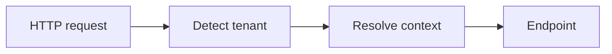

# Documentation guidelines

Organize package documentation around its components: a reader who wants to understand one piece
should find everything about it in one place. Complete scenarios that combine components live in a
separate Guides section. Before documenting a new package or feature, read through the existing
package docs to get a feeling for the tone and structure.

## Choose the right page type

| Page type | Include | Example |
| --- | --- | --- |
| Overview | What the package solves, a diagram of its components, which packages to install, and where to go next. | [Multi-tenancy](../guide/packages/multi-tenancy/index.md) |
| Quickstart | Prerequisites, one complete working example, ordered steps, and expected output. | [Quickstart](../guide/packages/multi-tenancy/quickstart.md) |
| Component | Everything about one component, in the order below. | [Caching](../guide/packages/multi-tenancy/management/caching.md) |
| Guide | A complete scenario combining components: what you'll build, all code, how to run it, and links to the components used. | [Background work](../guide/packages/multi-tenancy/guides/background-work.md) |
| Troubleshooting | Symptoms, each leading to a concrete check. | [Troubleshooting](../guide/packages/multi-tenancy/troubleshooting.md) |

Give component pages the same order, so readers always know where to look. Leave out sections a
component doesn't need:

1. An intro: what it does and when you need it
2. How it works — usually with a [diagram](#draw-flows-as-diagrams)
3. How to register it — a code group with one tab per variant, or its built-in variants
4. How to use it, in sections named after the reader's task, such as "Place the middleware"
5. Options, as a table
6. Behavior and limits: lifetimes, thread safety, consistency
7. How to extend it, such as "Provide a store" — only where replacing the component is intended,
   with the contract for your implementation as a table

Group component pages the way the packages are split, so readers who use only one package can skip
the rest.

## Make examples usable

- Name required packages and namespaces, including dependencies that are not transitive.
- Say whether a snippet is a complete file, startup configuration, or code inside an existing method.
- Use consistent sample names and IDs across a package's documentation.
- Include a successful result and relevant failure cases in quickstarts and guides.
- Label application-defined adapter types and incomplete snippets explicitly.
- Show a file name on complete files with a single-tab code group (` ```csharp [Program.cs] `).
- Check examples against the current public API. Build and run every guide against the local
  packages when changing it.

## Document extension contracts

For each replaceable component, explain what it owns, how to register it, its lifetime and
thread-safety requirements, and the meaning of null results and exceptions. Distinguish shipped
behavior from application responsibilities. Guides link to the component pages instead of
repeating their contracts.

Document behavior and guarantees, not the mechanism behind them: no internal type names, constants,
retry counts, or DI registration helpers. If a detail could change without breaking a caller, leave
it out. Name a mechanism only when readers must know it to avoid a pitfall, like the `AsyncLocal<T>`
behind the default tenant context accessor.

## Draw flows as diagrams

Use a diagram when a reader has to follow a flow or see how components connect. Write it as a
[Mermaid](https://mermaid.js.org/) code block; the site renders it in the browser with the site's
colors, in both light and dark mode:

````md

````


- Give every diagram an `accTitle` and `accDescr` so screen readers can describe it.
- Keep a diagram to one flow; split it when it no longer fits the content width.
- Name nodes after the types or steps used in the surrounding text.
- Diagrams use the Dagre layout. Opt in to ELK with `config: { layout: elk }` in the diagram's
  frontmatter only when Dagre's layout is unreadable; it loads a much larger script.

## Keep the site current

Update the package overview, the affected component pages and guides, and NuGet `PACKAGE.md`
together when behavior changes. Add new pages to `docs/.vitepress/en.ts`. Preserve existing page
URLs when reorganizing content, and describe current behavior rather than planned APIs.

Run `./build.sh docs` (from Git Bash on Windows) before completing documentation
work. Check internal links and the expected behavior of executable examples as well as the site build.
