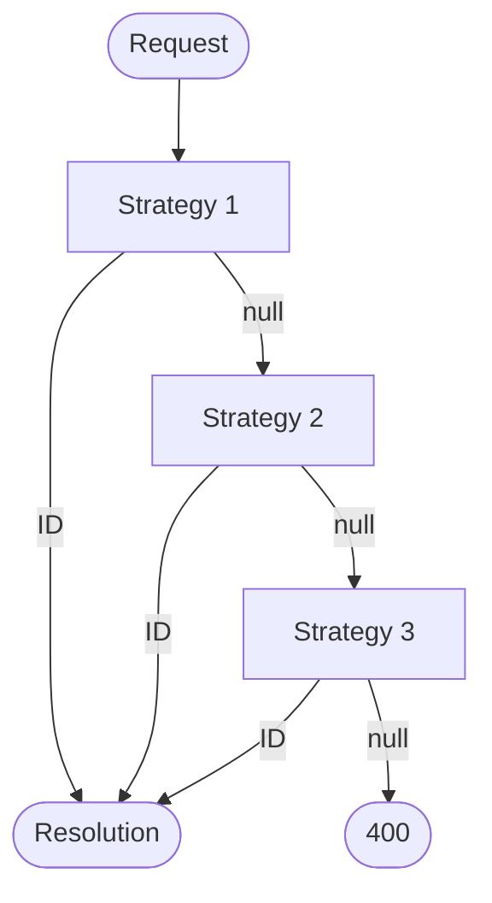

# Tenant detection

Detection answers **which tenant ID did the request supply?** It is the first step of the
[request pipeline](./pipeline.md). A detection strategy reads one source — a header, the host, a route
value, a claim — and returns an ID or `null`. It does not check whether the tenant exists; that is
[resolution](./resolution.md)'s job.

## How it works

Strategies run in the order you register them. The first one that returns an ID wins and the rest are
skipped. When every strategy returns `null`, the middleware rejects the request with **400**.



Detection happens once. If resolution later rejects the ID as unknown, the remaining strategies do
**not** get a second chance — the request gets 404. Order strategies deliberately when sources can
disagree; see [Combine strategies](#combine-strategies).

## Built-in strategies

### From a header

```csharp
builder.Services.AddMultiTenancy()
    .ConfigureRequestTenancy(request => request
        .DetectFromRequestHeader("X-Tenant"));
```

| Header | Detected ID |
| --- | --- |
| `X-Tenant: acme` | `acme` |
| Missing, empty, or whitespace | none |
| Several values | The first value |

It does not trim, normalize, or split the value. Use a header name your clients and any trusted proxy
agree on. Callers control headers, and selecting a tenant doesn't authorize the caller; see
[What Ayaka does not do](../index.md#what-ayaka-does-not-do).

### From the host

```csharp
builder.Services.AddMultiTenancy()
    .ConfigureRequestTenancy(request => request
        .DetectFromRequestHost());
```

| Host | Detected ID |
| --- | --- |
| `acme.example.com` | `acme` |
| `ACME.example.com` | `ACME` — casing is kept |
| `example.com` | `example` |
| `deep.acme.example.com:5080` | `deep` |
| `localhost:5080` | none |
| `127.0.0.1` | `127` |

It does not check a base domain, reject IP addresses, or lowercase the result. With
[tenant management](./resolution.md#tenant-management), IDs such as `www` or `ACME` are unknown
tenants and get **404**; if you need stricter rules, [write your own](#write-your-own) strategy. The
[database store guide](../guides/database-store.md) uses this strategy. Configure ASP.NET Core host
filtering and forwarded headers for your deployment; the strategy does not establish whether a host
is trusted.

## Combine strategies

```csharp
builder.Services.AddMultiTenancy()
    .ConfigureRequestTenancy(request => request
        .DetectFromRequestHeader("X-Tenant")
        .DetectFromRequestHost());
```

The host is consulted only when the header is absent.

## Write your own

Implement `ITenantDetectionStrategy` from `Ayaka.MultiTenancy.AspNetCore.Detection`. This strategy reads
the tenant from the signed-in user's `tenant_id` claim:

::: code-group

```csharp [ClaimTenantDetectionStrategy.cs]
using Ayaka.MultiTenancy.AspNetCore.Detection;

public sealed class ClaimTenantDetectionStrategy : ITenantDetectionStrategy
{
    public Task<string?> TryDetectAsync(HttpContext context)
    {
        var id = context.User.FindFirst("tenant_id")?.Value;

        return Task.FromResult(string.IsNullOrWhiteSpace(id) ? null : id);
    }
}
```

:::

::: code-group

```csharp [Created from DI]
builder.Services.AddMultiTenancy()
    .ConfigureRequestTenancy(request => request
        .DetectUsing<ClaimTenantDetectionStrategy>());
```

```csharp [Instance]
builder.Services.AddMultiTenancy()
    .ConfigureRequestTenancy(request => request
        .DetectUsing(new ClaimTenantDetectionStrategy()));
```

:::

A strategy that reads `HttpContext.User` needs `UseAuthentication()` before `UseMultiTenancy()`; see
[Place the middleware](./pipeline.md#place-the-middleware).

| Contract | |
| --- | --- |
| Signature | `Task<string?> TryDetectAsync(HttpContext context)` |
| No usable ID | Return `null`, so the next strategy runs. |
| Success | Return an ID in the format your tenants use, normalized the way your store compares IDs. Return `null` for anything else — empty, whitespace, too long, or with unexpected characters — so arbitrary input never reaches the resolver or the cache. |
| Cancellation | Use `context.RequestAborted`; there is no separate token parameter. |
| Failure | Throw; the exception propagates. |

**Lifetime.** A strategy is created once, at startup, and serves every request. `DetectUsing<T>()`
injects its constructor dependencies from DI; you don't register the strategy yourself. Treat a
strategy as a singleton: keep request state in local variables, make it safe for concurrent calls, and
don't inject scoped services such as a `DbContext` into its constructor. Resolve them from
`context.RequestServices` during the call instead.
