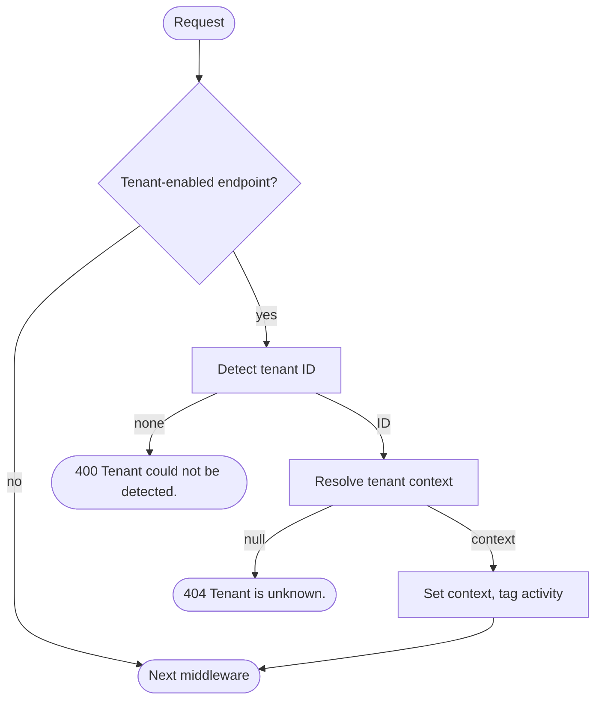

# Request pipeline

`RequestTenancyMiddleware` sets the [tenant context](../tenant-context.md) for every ASP.NET Core
request that needs one. It runs two replaceable steps — [detection](./detection.md) finds a tenant
ID in the request, [resolution](./resolution.md) turns that ID into a tenant context — and rejects
the request when either step comes up empty.

## How it works



A tenant-enabled endpoint is a matched endpoint without `DisableMultiTenancyAttribute`; everything
else passes through untouched.

## Register it

Configure request tenancy while registering services, then add the middleware once:

```csharp
builder.Services.AddProblemDetails();
builder.Services.AddMultiTenancy()
    .ConfigureRequestTenancy(request => request
        .DetectFromRequestHeader("X-Tenant"));

var app = builder.Build();

app.UseRouting();
app.UseMultiTenancy();
```

This example accepts any ID in the `X-Tenant` header; to reject unknown tenants, see
[Resolution](./resolution.md). Both methods are in `Ayaka.MultiTenancy.DependencyInjection`.

## Place the middleware

Place it **after routing**, so it can read the endpoint's metadata, and **before code that needs the
tenant**. With CORS, authentication, and authorization, a typical order is:

```csharp
app.UseRouting();
app.UseCors();
app.UseAuthentication();
app.UseMultiTenancy();
app.UseAuthorization();
```

- **CORS first**, so preflight requests complete without a tenant header.
- **Authentication first** when a detection strategy reads `HttpContext.User`. If authentication itself
  needs the tenant, place multi-tenancy before it and detect from something other than the user.
- **Authorization after**, so policies can check the caller against the resolved tenant.

If `UseMultiTenancy()` runs before `UseRouting()`, it sees no endpoint and lets every request through
without a tenant: no 400, no error. When you don't call `UseRouting()` yourself, `WebApplication`
adds routing at the start of the pipeline, before your middleware.

Which requests reach the middleware:

| Request | Tenant required? |
| --- | --- |
| No matched endpoint (for example an unknown route) | No — passes through unchanged. |
| Endpoint marked with `DisableMultiTenancyAttribute` | No — passes through unchanged. |
| Fallback routes and `MapStaticAssets()` endpoints | Yes, unless [marked](#allow-an-endpoint-without-a-tenant). |
| Static files served by earlier middleware | No — they never reach it. |
| Endpoints with `.ShortCircuit()` | No — they run during routing and bypass it. |
| A matched **405 Method Not Allowed** endpoint | Yes — a wrong-method request without a tenant gets 400. |

Add the middleware once: a second instance later in the pipeline finds the context already set and
throws. Exception handlers and status-code pages that re-execute the pipeline run detection and
resolution again — mark the error endpoint with `DisableMultiTenancyAttribute` so it still renders
when detection or resolution is what failed.

## Allow an endpoint without a tenant

::: code-group

```csharp [Minimal API]
app.MapGet("/health", () => Results.Ok("Healthy"))
    .WithMetadata(new DisableMultiTenancyAttribute());
```

```csharp [MVC]
[DisableMultiTenancy]
public sealed class HealthController : ControllerBase
{
    [HttpGet("/health")]
    public IActionResult Get() => Ok("Healthy");
}
```

```csharp [FastEndpoints]
public sealed class HealthEndpoint : EndpointWithoutRequest
{
    public override void Configure()
    {
        Get("/health");
        AllowAnonymous();
        Options(o => o.WithMetadata(new DisableMultiTenancyAttribute()));
    }

    public override Task HandleAsync(CancellationToken ct)
        => Send.OkAsync("Healthy", cancellation: ct);
}
```

```csharp [Route group]
var operations = app.MapGroup("/ops")
    .WithMetadata(new DisableMultiTenancyAttribute());

operations.MapGet("/health", () => Results.Ok("Healthy"));
operations.MapGet("/version", () => Results.Ok("1.0.0"));
```

```csharp [Static assets]
app.MapStaticAssets()
    .WithMetadata(new DisableMultiTenancyAttribute());
```

```csharp [SPA fallback]
app.MapFallbackToFile("index.html")
    .WithMetadata(new DisableMultiTenancyAttribute());
```

:::

`DisableMultiTenancyAttribute` is in `Ayaka.MultiTenancy.AspNetCore` and applies to a controller, an
action, or any endpoint or route group through `WithMetadata`. The middleware then skips detection,
resolution, and activity tagging. It does not clear a context set elsewhere.

## Problem details and tracing

Register `builder.Services.AddProblemDetails()` to get a response body for 400 and 404 rejections. The
body goes through ASP.NET Core's problem-details service, so `CustomizeProblemDetails` applies, and the
request's `Accept` header decides whether a body is written. Without the service, only the status code
is set.

After a successful resolution, the middleware adds the resolved tenant ID as a tag on the request's
activity (the ASP.NET Core server span). Rejected and skipped requests are not tagged. Change the tag
name with:

```csharp
builder.Services.AddMultiTenancy()
    .ConfigureRequestTenancy(request => request
        .DetectFromRequestHeader("X-Tenant")
        .UseCustomActivityTagName("app.tenant_id"));
```

Detection and resolution log at Debug level under `Ayaka.MultiTenancy.AspNetCore.RequestTenancyMiddleware`;
these logs can include tenant IDs. Rejection titles never do.

## Options

`ConfigureRequestTenancy(...)` passes you a builder with these methods:

| Builder method | Effect |
| --- | --- |
| `DetectFromRequestHeader(string headerName)` | Adds the [header strategy](./detection.md#from-a-header). |
| `DetectFromRequestHost()` | Adds the [host strategy](./detection.md#from-the-host). |
| `DetectUsing<T>()` / `DetectUsing(strategy)` | Adds a [custom strategy](./detection.md#write-your-own). |
| `ResolveWithTenantManagement()` | Selects the [tenant management resolver](./resolution.md#tenant-management). |
| `ResolveUsing<T>()` / `ResolveUsing(resolver)` | Selects a [custom resolver](./resolution.md#write-your-own). |
| `UseCustomActivityTagName(string tagName)` | Changes the activity tag name. |
| `MultiTenancy` | Returns to the parent `IMultiTenancyBuilder`. |

At least one `Detect…` method is required; startup fails without one. Without a `Resolve…` method,
the [detect-only resolver](./resolution.md#detect-only) is used. The activity tag is named `tenant`
unless you change it.

Request tenancy is read once at startup; strategies and resolvers live as long as the application.

## Behavior and limits

- **Tenant-enabled endpoints always have a context.** Requests without a known tenant are rejected
  before they reach your endpoint, so `ITenantContextAccessor.TenantContext` is never `null` there.
- **Scoped to the request.** The middleware sets the context for the rest of the pipeline, including
  your endpoint. Don't read it from work that you start from a request and don't await; copy the
  tenant ID into that work instead.
- **One owner per request.** If a tenant context is already set when a tenant-enabled endpoint is
  reached, the middleware throws `InvalidOperationException`. Don't set the context earlier in the
  pipeline; write a [detection strategy](./detection.md#write-your-own) instead.
- **Exceptions propagate.** Exceptions from detection, resolution, or your endpoint reach your
  exception handling; the middleware doesn't turn them into 400 or 404.
- **Long-lived connections are untested.** SignalR, WebSockets, and Blazor Server have not been tested
  with request tenancy.
