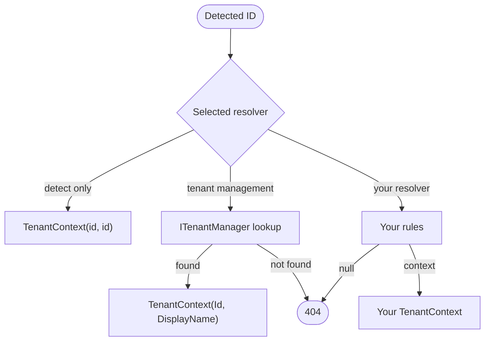

# Tenant resolution

Resolution answers **which tenant context does this ID represent?** It is the second step of the
[request pipeline](./pipeline.md): a resolver (`ITenantContextResolver`) receives the ID found by
[detection](./detection.md) and returns the `TenantContext` that becomes the current tenant — or
`null`, which rejects the request with **404**.

## How it works

Exactly one resolver is active. It decides whether unknown tenants are accepted, and what the
resulting context contains.



## Built-in resolvers

::: code-group

```csharp [Detect only (default)]
builder.Services.AddMultiTenancy()
    .ConfigureRequestTenancy(request => request
        .DetectFromRequestHeader("X-Tenant"));
```

```csharp [Tenant management]
builder.Services.AddMultiTenancy()
    .ConfigureRequestTenancy(request => request
        .DetectFromRequestHeader("X-Tenant")
        .ResolveWithTenantManagement())
    .AddTenantManagement()
    .UseInMemoryStore();
```

:::

### Detect only

The default. It returns `TenantContext(id, id)` for any detected ID, using the ID as display name. It
needs no tenant catalog and accepts every ID, which suits applications where an earlier layer — a
gateway or ingress — already routes and validates tenants and the application only needs the ID.

### Tenant management

`ResolveWithTenantManagement()` looks the ID up through `ITenantManager`:

| Lookup result | Outcome |
| --- | --- |
| Tenant found | Context with the tenant's `Id` and `DisplayName`. |
| No tenant | **404**, problem title `Tenant is unknown.` |
| Exception | Propagates to your exception handling (typically 500), no 404. |

It does not register management or a store: add
[`AddTenantManagement()`](../management/tenants.md) and a store, or resolving the manager fails at
startup. Enable [caching](../management/caching.md) so each request does not reach the store. To read
other tenant data, such as attributes, see [Tenant context](../tenant-context.md#context-and-tenant-data).

A successful lookup establishes that the tenant exists, not that the caller may access it; see
[What Ayaka does not do](../index.md#what-ayaka-does-not-do).

## Write your own

Implement `ITenantContextResolver` from `Ayaka.MultiTenancy.AspNetCore.Resolution`. This resolver
accepts `acme-eu` as an alias for the `acme` tenant and otherwise uses the normal lookup:

::: code-group

```csharp [AliasTenantContextResolver.cs]
using Ayaka.MultiTenancy;
using Ayaka.MultiTenancy.AspNetCore.Resolution;
using Ayaka.MultiTenancy.Management;

public sealed class AliasTenantContextResolver : ITenantContextResolver
{
    private readonly ITenantManager _tenants;

    public AliasTenantContextResolver(ITenantManager tenants)
    {
        _tenants = tenants;
    }

    public async ValueTask<TenantContext?> ResolveAsync(string id, CancellationToken cancellationToken)
    {
        var canonicalId = id == "acme-eu" ? "acme" : id;
        var tenant = await _tenants.GetAsync(canonicalId, cancellationToken);

        return tenant is null ? null : new TenantContext(tenant.Id, tenant.DisplayName);
    }
}
```

:::

```csharp
builder.Services.AddMultiTenancy()
    .ConfigureRequestTenancy(request => request
        .DetectFromRequestHeader("X-Tenant")
        .ResolveUsing<AliasTenantContextResolver>())
    .AddTenantManagement()
    .UseInMemoryStore();
```

`ResolveUsing(...)` also accepts an instance.

| Contract | |
| --- | --- |
| Signature | `ValueTask<TenantContext?> ResolveAsync(string id, CancellationToken cancellationToken)` |
| Known tenant | Return a context. Its `Id` can differ from the detected ID; the context and the activity tag use the resolved one. |
| Unknown tenant | Return `null` for **404**. |
| Failure | Throw; the exception propagates. |

**One resolver.** The last resolver configured wins; resolvers do not form a chain.

**Lifetime.** Like a strategy, a resolver is created once, at startup, and serves every request.
`ResolveUsing<T>()` injects its constructor dependencies from DI; you don't register the resolver
yourself. Make it safe for concurrent calls and don't inject scoped services into its constructor. A
resolver has no `HttpContext`; if it needs a scoped service, create and dispose a scope with
`IServiceScopeFactory`, or use a factory such as `IDbContextFactory<T>`.
