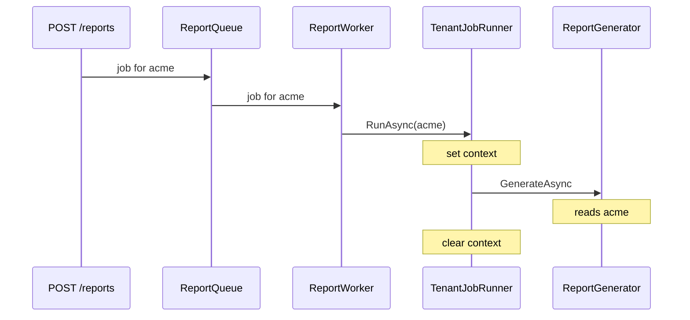

# Background work

Build a web API that accepts report requests and hands them to a background worker. The request runs
inside the tenant the middleware resolved; the worker has no HTTP request and no middleware, so it
establishes the tenant context itself for every job.



The key idea: **the tenant ID travels inside the job**, not through the ambient context. Execution
context does not flow through queues, and it never crosses processes; with a real broker, put the
tenant ID into the message.

## 1. Create the application

```sh
dotnet new web --name TenantApi
cd TenantApi
dotnet add package Ayaka.MultiTenancy --prerelease
dotnet add package Ayaka.MultiTenancy.AspNetCore --prerelease
```

## 2. Carry the tenant ID in the job

An in-process channel stands in for your message queue:

::: code-group

```csharp [ReportQueue.cs]
namespace TenantApi;

using System.Threading.Channels;

public sealed record ReportJob(string TenantId, Guid ReportId);

public sealed class ReportQueue
{
    private readonly Channel<ReportJob> _jobs = Channel.CreateUnbounded<ReportJob>();

    public ValueTask EnqueueAsync(ReportJob job, CancellationToken cancellationToken)
        => _jobs.Writer.WriteAsync(job, cancellationToken);

    public IAsyncEnumerable<ReportJob> ReadAllAsync(CancellationToken cancellationToken)
        => _jobs.Reader.ReadAllAsync(cancellationToken);
}
```

:::

## 3. Establish the context per job

The job runner looks the tenant up, sets the context, runs the work, and clears the context even when
the work throws. It refuses to run inside an existing context, so jobs never inherit a tenant by
accident.

::: code-group

```csharp [TenantJobRunner.cs]
namespace TenantApi;

using Ayaka.MultiTenancy;
using Ayaka.MultiTenancy.Management;

public sealed class TenantJobRunner
{
    private readonly ITenantManager _tenants;
    private readonly ITenantContextAccessor _accessor;

    public TenantJobRunner(ITenantManager tenants, ITenantContextAccessor accessor)
    {
        _tenants = tenants;
        _accessor = accessor;
    }

    public async Task RunAsync(
        string tenantId,
        Func<CancellationToken, Task> work,
        CancellationToken cancellationToken)
    {
        if (_accessor.TenantContext is not null)
        {
            throw new InvalidOperationException("A tenant context is already active.");
        }

        var tenant = await _tenants.GetAsync(tenantId, cancellationToken)
            ?? throw new InvalidOperationException($"Tenant '{tenantId}' is unknown.");

        _accessor.TenantContext = new TenantContext(tenant.Id, tenant.DisplayName);
        try
        {
            await work(cancellationToken);
        }
        finally
        {
            _accessor.TenantContext = null;
        }
    }
}
```

:::

Looking the tenant up rejects jobs for tenants that were removed after the job was queued. If the job's
tenant ID is already trusted and you need no catalog, set `new TenantContext(tenantId, displayName)`
directly with the same `try`/`finally` pattern; `AddTenantContextAccessor()` alone is enough for that.

## 4. Process jobs in a worker

The worker creates a DI scope per job for scoped services. The scope and the tenant context are
independent: the scope does not set a tenant, the runner does.

::: code-group

```csharp [ReportWorker.cs]
namespace TenantApi;

using Ayaka.MultiTenancy;

public sealed class ReportWorker : BackgroundService
{
    private readonly ReportQueue _queue;
    private readonly IServiceScopeFactory _scopes;
    private readonly ILogger<ReportWorker> _logger;

    public ReportWorker(ReportQueue queue, IServiceScopeFactory scopes, ILogger<ReportWorker> logger)
    {
        _queue = queue;
        _scopes = scopes;
        _logger = logger;
    }

    protected override async Task ExecuteAsync(CancellationToken stoppingToken)
    {
        await foreach (var job in _queue.ReadAllAsync(stoppingToken))
        {
            try
            {
                await using var scope = _scopes.CreateAsyncScope();
                var runner = scope.ServiceProvider.GetRequiredService<TenantJobRunner>();
                var reports = scope.ServiceProvider.GetRequiredService<ReportGenerator>();

                await runner.RunAsync(
                    job.TenantId,
                    ct => reports.GenerateAsync(job.ReportId, ct),
                    stoppingToken);
            }
            catch (Exception exception) when (exception is not OperationCanceledException)
            {
                _logger.LogError(exception, "Report {ReportId} failed", job.ReportId);
            }
        }
    }
}

public sealed class ReportGenerator
{
    private readonly ITenantContextAccessor _accessor;
    private readonly ILogger<ReportGenerator> _logger;

    public ReportGenerator(ITenantContextAccessor accessor, ILogger<ReportGenerator> logger)
    {
        _accessor = accessor;
        _logger = logger;
    }

    public Task GenerateAsync(Guid reportId, CancellationToken cancellationToken)
    {
        var tenant = _accessor.TenantContext
            ?? throw new InvalidOperationException("Reports must run inside a tenant context.");

        _logger.LogInformation("Generating report {ReportId} for {Tenant}", reportId, tenant.DisplayName);
        return Task.CompletedTask;
    }
}
```

:::

`ReportGenerator` reads the tenant exactly like it would during an HTTP request. Services don't need
to know whether they run in a request or a job.

## 5. Wire it up

Replace `Program.cs` with:

::: code-group

```csharp [Program.cs]
using Ayaka.MultiTenancy;
using Ayaka.MultiTenancy.DependencyInjection;
using Ayaka.MultiTenancy.Management;
using TenantApi;

var builder = WebApplication.CreateBuilder(args);

builder.Services.AddProblemDetails();
builder.Services.AddMultiTenancy()
    .ConfigureRequestTenancy(request => request
        .DetectFromRequestHeader("X-Tenant")
        .ResolveWithTenantManagement())
    .AddTenantManagement()
    .UseInMemoryStore();

builder.Services.AddSingleton<ReportQueue>();
builder.Services.AddScoped<TenantJobRunner>();
builder.Services.AddScoped<ReportGenerator>();
builder.Services.AddHostedService<ReportWorker>();

var app = builder.Build();

var tenants = app.Services.GetRequiredService<ITenantManager>();
await tenants.AddAsync(new Tenant("acme", "Acme"));
await tenants.AddAsync(new Tenant("contoso", "Contoso"));

app.UseRouting();
app.UseMultiTenancy();

app.MapPost("/reports", async (ITenantContextAccessor accessor, ReportQueue queue, CancellationToken ct) =>
{
    var job = new ReportJob(accessor.TenantContext!.Id, Guid.NewGuid());
    await queue.EnqueueAsync(job, ct);

    return Results.Accepted(value: new { job.ReportId });
});

await app.RunAsync();
```

:::

### Without ASP.NET Core

A worker service that never handles HTTP requests needs only `Ayaka.MultiTenancy`. Build a
`Host.CreateApplicationBuilder(args)` instead, register tenant management without
`ConfigureRequestTenancy(...)`, and leave out `UseRouting()`, `UseMultiTenancy()`, and the endpoint;
jobs then come from your message consumer instead of a request. The rest stays the same:

```csharp
builder.Services.AddMultiTenancy()
    .AddTenantManagement()
    .UseInMemoryStore();
```

## 6. Run it

```sh
dotnet run --no-launch-profile --urls http://localhost:5080
```

```sh
curl -X POST -H "X-Tenant: acme" http://localhost:5080/reports
curl -X POST -H "X-Tenant: contoso" http://localhost:5080/reports
```

Each request returns **202 Accepted** with a report ID, and the application logs:

```text
info: TenantApi.ReportGenerator[0]
      Generating report dd36c98e-… for Acme
info: TenantApi.ReportGenerator[0]
      Generating report a91cdffb-… for Contoso
```

A request without `X-Tenant` is rejected with **400** before anything is queued.

## Rules to keep

- **Await before clearing.** All tenant-aware work must finish inside `RunAsync`. Work started and not
  awaited loses its tenant when the context is cleared.
- **One context per job.** For parallel jobs, establish the context inside each job's own execution
  flow, as the worker does, rather than changing a shared context while other work still uses it.

## Components used

- [Tenant context](../tenant-context.md#set-the-context-yourself) — owning the context outside HTTP
- [Managing tenants](../management/tenants.md) — looking up the job's tenant
- [Request pipeline](../aspnetcore/pipeline.md) — the tenant of the enqueuing request
