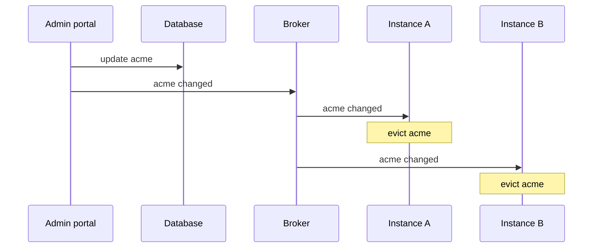

# Keep cached tenants in sync

[Caching](../management/caching.md) tenant lookups makes requests fast, but cached tenants can go stale:

- **Another application** — an admin portal, an import job — writes to the tenant database directly.
  The tenant manager never sees the change, so nothing is evicted.
- **Several instances** run your application. A write through the manager on one instance evicts the
  tenant there, but every other instance keeps its local copy.

In both cases the stale entry lives until it expires. This guide makes every instance evict a tenant
as soon as it changes, by distributing change notifications.



## 1. Create the application

```sh
dotnet new web --name TenantApi
cd TenantApi
dotnet add package Ayaka.MultiTenancy --prerelease
dotnet add package Ayaka.MultiTenancy.AspNetCore --prerelease
```

## 2. Receive change notifications

In production this is a subscription to your message broker — Redis pub/sub, Azure Service Bus topics,
RabbitMQ fan-out — where **every instance receives every message**. An in-process channel stands in
for it here:

::: code-group

```csharp [TenantChangeFeed.cs]
namespace TenantApi;

using System.Threading.Channels;

/// <summary>
/// Stand-in for your message broker: every application instance receives every change.
/// </summary>
public sealed class TenantChangeFeed
{
    private readonly Channel<string> _changes = Channel.CreateUnbounded<string>();

    public ValueTask PublishAsync(string tenantId, CancellationToken cancellationToken)
        => _changes.Writer.WriteAsync(tenantId, cancellationToken);

    public IAsyncEnumerable<string> ReadAllAsync(CancellationToken cancellationToken)
        => _changes.Reader.ReadAllAsync(cancellationToken);
}
```

:::

## 3. Evict on every change

A hosted service turns each notification into a cache eviction. `*` stands for a bulk change, such as
an import, and evicts every tenant:

::: code-group

```csharp [TenantCacheInvalidator.cs]
namespace TenantApi;

using Ayaka.MultiTenancy.Management;

public sealed class TenantCacheInvalidator : BackgroundService
{
    public const string AllTenants = "*";

    private readonly TenantChangeFeed _feed;
    private readonly ITenantCache _cache;
    private readonly ILogger<TenantCacheInvalidator> _logger;

    public TenantCacheInvalidator(TenantChangeFeed feed, ITenantCache cache, ILogger<TenantCacheInvalidator> logger)
    {
        _feed = feed;
        _cache = cache;
        _logger = logger;
    }

    protected override async Task ExecuteAsync(CancellationToken stoppingToken)
    {
        await foreach (var tenantId in _feed.ReadAllAsync(stoppingToken))
        {
            try
            {
                if (tenantId == AllTenants)
                {
                    await _cache.EvictAllAsync(stoppingToken);
                }
                else
                {
                    await _cache.EvictAsync(tenantId, stoppingToken);
                }

                _logger.LogInformation("Evicted cached tenant {TenantId}", tenantId);
            }
            catch (Exception exception) when (exception is not OperationCanceledException)
            {
                _logger.LogWarning(exception, "Failed to evict cached tenant {TenantId}", tenantId);
            }
        }
    }
}
```

:::

Evict through `ITenantCache`, not through `HybridCache` directly: only the interface also drops
lookups that were still loading when the change arrived.

## 4. Wire it up

Replace `Program.cs` with the following. The `/external/tenants/{id}` endpoint plays the other
application: it writes to the store directly, bypassing the manager, and publishes a notification only
when `notify=true`. Don't do this in an application — it only simulates a writer the manager doesn't
see.

::: code-group

```csharp [Program.cs]
using Ayaka.MultiTenancy;
using Ayaka.MultiTenancy.AspNetCore;
using Ayaka.MultiTenancy.DependencyInjection;
using Ayaka.MultiTenancy.Management;
using TenantApi;

var builder = WebApplication.CreateBuilder(args);

builder.Services.AddProblemDetails();
builder.Services.AddMultiTenancy()
    .ConfigureRequestTenancy(request => request
        .DetectFromRequestHeader("X-Tenant")
        .ResolveWithTenantManagement())
    .AddTenantManagement()
    .UseInMemoryStore()
    .UseHybridCache(options => options.Expiration = TimeSpan.FromMinutes(30));

builder.Services.AddSingleton<TenantChangeFeed>();
builder.Services.AddHostedService<TenantCacheInvalidator>();

var app = builder.Build();

var tenants = app.Services.GetRequiredService<ITenantManager>();
await tenants.AddAsync(new Tenant("acme", "Acme"));

app.UseRouting();
app.UseMultiTenancy();

app.MapGet("/tenant", (ITenantContextAccessor accessor) => Results.Ok(accessor.TenantContext));

// Simulates another application that writes to the tenant database directly
app.MapPut("/external/tenants/{id}", async (string id, string displayName, bool notify, ITenantStore store, TenantChangeFeed feed) =>
{
    await store.UpdateAsync(new Tenant(id, displayName));
    if (notify)
    {
        await feed.PublishAsync(id, CancellationToken.None);
    }

    return Results.NoContent();
}).WithMetadata(new DisableMultiTenancyAttribute());

await app.RunAsync();
```

:::

## 5. Run it

```sh
dotnet run --no-launch-profile --urls http://localhost:5080
```

```sh
curl -H "X-Tenant: acme" http://localhost:5080/tenant
# {"id":"acme","displayName":"Acme"}

curl -X PUT "http://localhost:5080/external/tenants/acme?displayName=Acme%20Europe&notify=false"
curl -H "X-Tenant: acme" http://localhost:5080/tenant
# {"id":"acme","displayName":"Acme"}          <- stale: served from the cache

curl -X PUT "http://localhost:5080/external/tenants/acme?displayName=Acme%20Global&notify=true"
curl -H "X-Tenant: acme" http://localhost:5080/tenant
# {"id":"acme","displayName":"Acme Global"}   <- evicted, reloaded from the store
```

Without a notification the old name stays for up to the 30-minute expiration. With one, the next
request already sees the change.

## Choose your strategy

| Situation | Approach |
| --- | --- |
| One instance, all writes through `ITenantManager` | Nothing to do — the manager [evicts automatically](../management/caching.md#behavior-and-limits). |
| Writes outside the manager, or several instances | Publish a change notification and evict on every instance, as above. |
| Notifications are not possible | Rely on expiration alone and lower `TenantCacheOptions.Expiration` to the staleness you can accept (minimum 1 minute). |

Notifications and expiration combine well: notifications make changes visible immediately, and the
expiration bounds the damage if one is lost.

## Components used

- [Caching](../management/caching.md#invalidate-after-external-changes) — eviction and its limits
- [Managing tenants](../management/tenants.md#behavior-and-limits) — automatic eviction on writes
