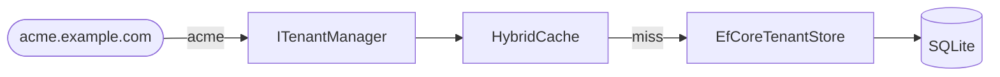

# Database-backed tenant store

Build an application whose tenant catalog lives in a database, with lookups cached in memory. Every
tenant has its own subdomain — `acme.example.com`, `contoso.example.com`; locally, `acme.localhost`
stands in for `acme.example.com`.



## 1. Create the application

```sh
dotnet new web --name TenantApi
cd TenantApi
dotnet add package Ayaka.MultiTenancy --prerelease
dotnet add package Ayaka.MultiTenancy.AspNetCore --prerelease
dotnet add package Microsoft.EntityFrameworkCore.Sqlite
```

SQLite keeps the example self-contained; any EF Core provider works the same way.

## 2. Store tenants in a database

The tenant catalog is an ordinary EF Core model. Attributes are stored as a JSON column, so any
attribute your application defines round-trips without schema changes.

::: code-group

```csharp [TenantCatalogDbContext.cs]
namespace TenantApi;

using Microsoft.EntityFrameworkCore;

public sealed class TenantCatalogDbContext : DbContext
{
    public TenantCatalogDbContext(DbContextOptions<TenantCatalogDbContext> options)
        : base(options)
    {
    }

    public DbSet<TenantRecord> Tenants => Set<TenantRecord>();
}

public sealed class TenantRecord
{
    public required string Id { get; set; }

    public string? DisplayName { get; set; }

    public string? AttributesJson { get; set; }
}
```

:::

The store implements [`ITenantStore`](../management/tenants.md#provide-a-store). The tenant manager is a
singleton and keeps its store, so the store uses `IDbContextFactory<T>` to create a short-lived
`DbContext` per operation instead of capturing a scoped one.

::: code-group

```csharp [EfCoreTenantStore.cs]
namespace TenantApi;

using System.Collections.Immutable;
using System.Text.Json;
using Ayaka.MultiTenancy.Management;
using Microsoft.EntityFrameworkCore;

public sealed class EfCoreTenantStore : ITenantStore
{
    private readonly IDbContextFactory<TenantCatalogDbContext> _contexts;

    public EfCoreTenantStore(IDbContextFactory<TenantCatalogDbContext> contexts)
    {
        _contexts = contexts;
    }

    public async Task AddAsync(Tenant tenant, CancellationToken cancellationToken = default)
    {
        await using var db = await _contexts.CreateDbContextAsync(cancellationToken);

        if (await db.Tenants.AnyAsync(x => x.Id == tenant.Id, cancellationToken))
        {
            throw new TenantManagementException($"Tenant '{tenant.Id}' already exists.");
        }

        db.Tenants.Add(ToRecord(tenant));
        await db.SaveChangesAsync(cancellationToken);
    }

    public async Task UpdateAsync(Tenant tenant, CancellationToken cancellationToken = default)
    {
        await using var db = await _contexts.CreateDbContextAsync(cancellationToken);

        var record = await db.Tenants.SingleOrDefaultAsync(x => x.Id == tenant.Id, cancellationToken)
            ?? throw new TenantManagementException($"Tenant '{tenant.Id}' does not exist.");

        record.DisplayName = tenant.DisplayName;
        record.AttributesJson = SerializeAttributes(tenant.Attributes);
        await db.SaveChangesAsync(cancellationToken);
    }

    public async Task<bool> RemoveAsync(string id, CancellationToken cancellationToken = default)
    {
        await using var db = await _contexts.CreateDbContextAsync(cancellationToken);

        return await db.Tenants.Where(x => x.Id == id).ExecuteDeleteAsync(cancellationToken) > 0;
    }

    public async Task<Tenant?> GetAsync(string id, CancellationToken cancellationToken = default)
    {
        await using var db = await _contexts.CreateDbContextAsync(cancellationToken);

        var record = await db.Tenants.AsNoTracking().SingleOrDefaultAsync(x => x.Id == id, cancellationToken);
        return record is null ? null : ToTenant(record);
    }

    public async Task<IReadOnlyList<Tenant>> GetAllAsync(CancellationToken cancellationToken = default)
    {
        await using var db = await _contexts.CreateDbContextAsync(cancellationToken);

        var records = await db.Tenants.AsNoTracking().ToListAsync(cancellationToken);
        return records.Select(ToTenant).ToList();
    }

    private static TenantRecord ToRecord(Tenant tenant) => new()
    {
        Id = tenant.Id,
        DisplayName = tenant.DisplayName,
        AttributesJson = SerializeAttributes(tenant.Attributes),
    };

    private static Tenant ToTenant(TenantRecord record) => new(
        record.Id,
        record.DisplayName,
        record.AttributesJson is null
            ? null
            : JsonSerializer.Deserialize<Dictionary<string, string>>(record.AttributesJson)!.ToImmutableDictionary());

    private static string? SerializeAttributes(ImmutableDictionary<string, string>? attributes)
        => attributes is null ? null : JsonSerializer.Serialize(attributes);
}
```

:::

The duplicate check before inserting gives the clear `TenantManagementException` the contract asks for.
Two concurrent inserts of the same ID can still both pass it; the primary key then rejects the second
with a `DbUpdateException`.

## 3. Wire it up

Replace `Program.cs` with:

::: code-group

```csharp [Program.cs]
using System.Collections.Immutable;
using Ayaka.MultiTenancy;
using Ayaka.MultiTenancy.AspNetCore;
using Ayaka.MultiTenancy.DependencyInjection;
using Ayaka.MultiTenancy.Management;
using Microsoft.EntityFrameworkCore;
using TenantApi;

var builder = WebApplication.CreateBuilder(args);

builder.Services.AddDbContextFactory<TenantCatalogDbContext>(options =>
    options.UseSqlite("Data Source=tenants.db"));
builder.Services.AddSingleton<ITenantStore, EfCoreTenantStore>();

builder.Services.AddProblemDetails();
builder.Services.AddMultiTenancy()
    .ConfigureRequestTenancy(request => request
        .DetectFromRequestHost()
        .ResolveWithTenantManagement())
    .AddTenantManagement()
    .UseHybridCache(options => options.Expiration = TimeSpan.FromMinutes(10));

var app = builder.Build();

await SeedTenantsAsync(app.Services);

app.UseRouting();
app.UseMultiTenancy();

app.MapGet("/", async (ITenantContextAccessor accessor, ITenantManager tenants, CancellationToken ct) =>
{
    var tenant = await tenants.GetAsync(accessor.TenantContext!.Id, ct);

    return Results.Ok(new
    {
        tenant!.Id,
        tenant.DisplayName,
        Region = tenant.Attributes?.GetValueOrDefault("region"),
    });
});

app.MapGet("/health", () => Results.Ok("Healthy"))
    .WithMetadata(new DisableMultiTenancyAttribute());

await app.RunAsync();

static async Task SeedTenantsAsync(IServiceProvider services)
{
    var contexts = services.GetRequiredService<IDbContextFactory<TenantCatalogDbContext>>();
    await using (var db = await contexts.CreateDbContextAsync())
    {
        await db.Database.EnsureCreatedAsync();
    }

    var tenants = services.GetRequiredService<ITenantManager>();
    if (await tenants.GetAsync("acme") is null)
    {
        await tenants.AddAsync(new Tenant(
            "acme",
            "Acme",
            ImmutableDictionary<string, string>.Empty.Add("region", "eu")));
    }

    if (await tenants.GetAsync("contoso") is null)
    {
        await tenants.AddAsync(new Tenant(
            "contoso",
            "Contoso",
            ImmutableDictionary<string, string>.Empty.Add("region", "us")));
    }
}
```

:::

- `DetectFromRequestHost()` takes the tenant ID from the leftmost part of the host, so
  `acme.localhost` is the tenant `acme`.
- `AddSingleton<ITenantStore, EfCoreTenantStore>()` replaces the in-memory store; `AddTenantManagement()`
  does not register a store of its own.
- `UseHybridCache(...)` caches lookups for ten minutes. The endpoint looks the tenant up a second time
  to read its region attribute (see [Tenant context](../tenant-context.md#context-and-tenant-data)); that lookup is
  served from the cache the resolver just filled.
- `EnsureCreatedAsync()` and the seeding keep the example short. Use EF Core migrations and your own
  provisioning process in a real application.

## 4. Run it

```sh
dotnet run --no-launch-profile --urls http://localhost:5080
```

`*.localhost` resolves to your machine, so the subdomains work without any DNS setup:

| Request | Result |
| --- | --- |
| `curl http://acme.localhost:5080/` | **200** `{"id":"acme","displayName":"Acme","region":"eu"}` |
| `curl http://contoso.localhost:5080/` | **200** `{"id":"contoso","displayName":"Contoso","region":"us"}` |
| `curl http://unknown.localhost:5080/` | **404** `Tenant is unknown.` |
| `curl http://localhost:5080/` | **400** `Tenant could not be detected.` |
| `curl http://localhost:5080/health` | **200** without a tenant |

Restart the application: the tenants are still there, read from `tenants.db`.

The host strategy keeps the host's casing and doesn't check your domain: `ACME.localhost` detects
`ACME`, and `www.example.com` detects `www`. Both are unknown tenants and get **404**. See
[From the host](../aspnetcore/detection.md#from-the-host) for its limits.

## Components used

- [Tenant detection](../aspnetcore/detection.md#from-the-host) — the host strategy
- [Tenant resolution](../aspnetcore/resolution.md#tenant-management) — rejecting unknown tenants
- [Managing tenants](../management/tenants.md#provide-a-store) — the store contract
- [Caching](../management/caching.md) — HybridCache in front of the database
