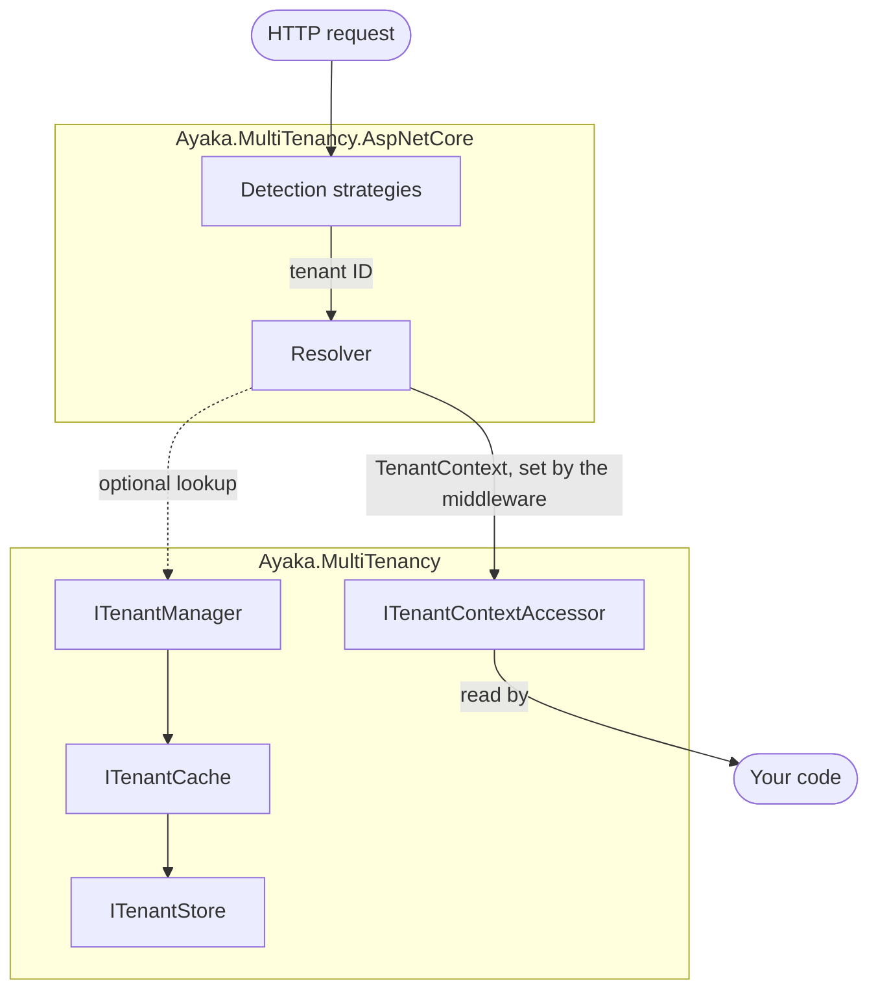

# Multi-tenancy

Ayaka.MultiTenancy answers one question for every piece of work in a .NET application:
**which tenant is this for?** A tenant might be a customer organization, a workspace, or an account.
Ayaka carries the tenant's identity through an execution flow, keeps a catalog of known tenants,
and selects the tenant for each ASP.NET Core request.

::: warning Preview
The multi-tenancy packages are in preview. Their API can change between releases; check the release
notes when you update.
:::

## How the pieces fit together

Outside HTTP requests (background jobs, message handlers), your code sets the tenant context itself;
see [Background work](./guides/background-work.md).

| Component | What it does | Read more |
| --- | --- | --- |
| Tenant context | Holds the current tenant for the running execution flow. | [Tenant context](./tenant-context.md) |
| Tenant management | Adds, updates, removes, and looks up known tenants in a store. | [Managing tenants](./management/tenants.md) |
| Tenant caching | Keeps tenant lookups in memory so requests do not hit the store every time. | [Caching](./management/caching.md) |
| Request pipeline | Middleware that sets the tenant context for each ASP.NET Core request. | [Request pipeline](./aspnetcore/pipeline.md) |
| Tenant detection | Reads a tenant ID from a header, the host, or your own source. | [Tenant detection](./aspnetcore/detection.md) |
| Tenant resolution | Turns a detected ID into a tenant context, optionally rejecting unknown tenants. | [Tenant resolution](./aspnetcore/resolution.md) |

## Choose your packages

| Package | Use it for |
| --- | --- |
| `Ayaka.MultiTenancy.Abstractions` | Contracts and models, for libraries that should not choose an implementation. |
| `Ayaka.MultiTenancy` | The tenant context accessor, tenant management, the in-memory store, and HybridCache integration. |
| `Ayaka.MultiTenancy.AspNetCore` | Request detection, context resolution, and middleware for ASP.NET Core. |

For a web application, install `Ayaka.MultiTenancy` and `Ayaka.MultiTenancy.AspNetCore`; a worker
service needs only `Ayaka.MultiTenancy`. Both require `ILoggerFactory`, which ASP.NET Core and the
Generic Host register for you.

| Namespace | Contains |
| --- | --- |
| `Ayaka.MultiTenancy` | `TenantContext`, `ITenantContextAccessor`, `AddMultiTenancy()` |
| `Ayaka.MultiTenancy.Management` | `Tenant`, `ITenantManager`, `ITenantStore`, `ITenantCache`, `TenantCacheOptions` |
| `Ayaka.MultiTenancy.DependencyInjection` | Builder interfaces and their registration extensions, `UseMultiTenancy()` |
| `Ayaka.MultiTenancy.AspNetCore` | `RequestTenancyMiddleware`, `RequestTenancyOptions`, `DisableMultiTenancyAttribute` |
| `Ayaka.MultiTenancy.AspNetCore.Detection` | `ITenantDetectionStrategy` and the built-in strategies |
| `Ayaka.MultiTenancy.AspNetCore.Resolution` | `ITenantContextResolver` |

## What Ayaka does not do

Your application decides how the tenant identity affects its data and services. Ayaka does not
filter database queries, choose connection strings, provision databases, authenticate users, or check
whether a user belongs to a tenant. Selecting a tenant, whether from a header, a host, or anything
else the caller controls, establishes which tenant a request targets, not that the caller may access
it; your authorization policies decide that.

## Where to go next

- [Quickstart](./quickstart.md) — a working tenant-aware API in a few minutes.
- Guides — complete scenarios that combine several components:
  - [Database-backed tenant store](./guides/database-store.md)
  - [Background work](./guides/background-work.md)
  - [Keep cached tenants in sync](./guides/cache-sync.md)
- [Troubleshooting](./troubleshooting.md) — start from a response or exception you see.
