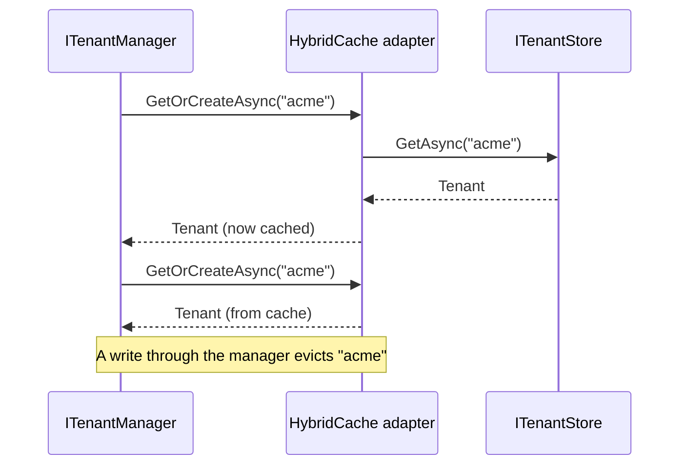

# Caching

Every request that requires a known tenant looks it up through `ITenantManager`. Caching keeps those
lookups in memory, so a slow or remote [tenant store](./tenants.md) is not queried on every request.
Tenant management does not cache by default; enable it when your store is anything but in-memory.

The cache applies to `ITenantManager.GetAsync()`, including the lookups made by
[`ResolveWithTenantManagement()`](../aspnetcore/resolution.md). It does not cache `GetAllAsync()` or
any of your application's data.

## How it works

Ayaka's adapter stores tenants in Microsoft's
[`HybridCache`](https://learn.microsoft.com/aspnet/core/performance/caching/hybrid): a local in-memory
cache, optionally backed by a distributed cache such as Redis. Concurrent lookups for the same tenant
share a single store load.



Missing tenants are cached too, so repeated requests for an unknown ID do not reach the store either.
Adding that tenant through the manager evicts the cached miss.

## Register it

::: code-group

```csharp [HybridCache]
builder.Services.AddMultiTenancy()
    .AddTenantManagement()
    .UseInMemoryStore()
    .UseHybridCache(options =>
    {
        options.Expiration = TimeSpan.FromMinutes(10);
    });
```

```csharp [Keyed HybridCache]
builder.Services.AddKeyedHybridCache("tenant-catalog");

builder.Services.AddMultiTenancy()
    .AddTenantManagement()
    .UseInMemoryStore()
    .UseKeyedHybridCache("tenant-catalog", options =>
    {
        options.Expiration = TimeSpan.FromMinutes(2);
    });
```

:::

The in-memory store keeps the examples self-contained; a persistent store uses the same cache
configuration.

- **`UseHybridCache()`** registers `HybridCache` and selects Ayaka's adapter. A registered
  `IDistributedCache` becomes the second level automatically; Ayaka does not install or configure one.
- **`UseKeyedHybridCache()`** uses a keyed `HybridCache` that you register yourself, which separates the
  tenant catalog's cache settings from the rest of the application. It does not create the keyed
  instance: a missing registration fails when the tenant cache is first resolved. For a keyed
  distributed backend, set the keyed cache's `DistributedCacheServiceKey` to match your
  `IDistributedCache` registration.

Call only one of `UseHybridCache()` and `UseKeyedHybridCache()`.

## Invalidate after external changes

Writes through `ITenantManager` evict the affected tenant automatically; inside your application,
always write through the manager. When something the manager doesn't see changes the store, such as
another application or a database script, evict the changed tenants through `ITenantCache`:

```csharp
await cache.EvictAsync("acme", CancellationToken.None);

// When you can't tell which tenants changed
await cache.EvictAllAsync(CancellationToken.None);
```

Evict only after the change is stored, and don't cancel the eviction once it is; otherwise the old
tenant stays cached until it expires. With several instances, every instance must evict; the
[cache sync guide](../guides/cache-sync.md) shows how to react to change notifications.

## Options

`TenantCacheOptions` is in `Ayaka.MultiTenancy.Management`.

| Property | Default | Meaning |
| --- | --- | --- |
| `TimeSpan Expiration` | 5 minutes | How long an entry lives, in both the local and the distributed cache. Must be between 1 minute and 1 hour, inclusive; validated at host startup. |

The expiration bounds how long a tenant changed outside the manager can stay stale. Choose it from
your tolerance for stale catalog data.

## Behavior and limits

- **Writes evict.** A write through `ITenantManager` goes to the store first and then evicts the
  tenant. A failed store write evicts nothing. Once the store write succeeds, the eviction runs even if
  the caller cancels; if the eviction fails, the failure is logged as a warning and the write still
  stands. Removing an unknown ID evicts it too, which clears a cached miss.
- **Unknown IDs are cached too.** Every distinct ID stays cached until it expires, in the distributed
  cache as well if you use one. Reject malformed IDs in your
  [detection strategy](../aspnetcore/detection.md#write-your-own), so arbitrary input never reaches the
  cache or the store.
- **Evictions during a lookup.** If a tenant is evicted while its lookup is still loading from the
  store, the cache drops that result — found or not — and loads again. This narrows the window for
  stale data but is not a transaction with the store.
- **Evictions are per instance.** Evicting removes the tenant from this instance's local cache and from
  the distributed cache; other instances keep their local copy until it expires. With several
  instances, distribute invalidations yourself — the [cache sync guide](../guides/cache-sync.md) shows
  how.

## Replace the cache

Implement `ITenantCache` and register it as a singleton before calling `AddTenantManagement()`.

| Member | Contract |
| --- | --- |
| `GetOrCreateAsync(string id, Func<string, CancellationToken, ValueTask<Tenant?>> factory, CancellationToken)` | Return the cached tenant or call the factory. A `null` result is a valid miss. |
| `EvictAsync(string id, CancellationToken)` | Remove one tenant. |
| `EvictAllAsync(CancellationToken)` | Remove every tenant. |
| Failure | Throw; the exception propagates to the caller of the manager. If the factory throws, let its exception through and cache nothing. An eviction that fails after a write through the manager is logged as a warning instead, and the write still stands. |

Behave like the built-in cache: cache misses too, so unknown IDs don't reach the store on every
request, and let concurrent lookups for the same ID share a single factory call. Decide how
concurrent loads and evictions interact, including an eviction while a load is running.
