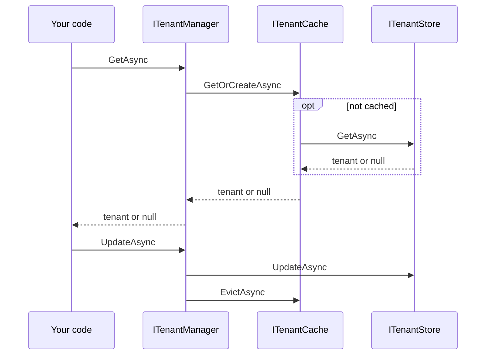

# Managing tenants

Tenant management keeps the catalog of tenants your application knows about. `ITenantManager` is the
single entry point: the [request pipeline](../aspnetcore/resolution.md) uses it to reject unknown
tenants, and your application uses it to add, update, remove, and look up tenants. You need it when a
tenant must exist before it can be used, or when you store data about tenants, such as a region.

## How it works

The manager sits in front of two replaceable parts: an `ITenantStore` that persists tenants, and an
`ITenantCache` that keeps single-tenant lookups in memory. By default the cache passes every lookup
straight through to the store; see [Caching](./caching.md) to enable it.



`GetAllAsync()` reads the store directly and is not cached.

## Register it

::: code-group

```csharp [In-memory store]
builder.Services.AddMultiTenancy()
    .AddTenantManagement()
    .UseInMemoryStore();
```

```csharp [Your own store]
builder.Services.AddSingleton<ITenantStore, DatabaseTenantStore>();
builder.Services.AddMultiTenancy()
    .AddTenantManagement();
```

:::

`AddTenantManagement()` registers the manager and a pass-through cache, but **no store**.
Choose one with `UseInMemoryStore()` or register your own `ITenantStore`; otherwise resolving the
manager fails. `DatabaseTenantStore` stands for your own implementation; see
[Provide a store](#provide-a-store).

## Use it

Inject `ITenantManager` into your services. Every method takes an optional `CancellationToken` as its
last argument.

::: code-group

```csharp [Add and read]
await tenants.AddAsync(new Tenant("acme", "Acme"));

var acme = await tenants.GetAsync("acme");
var missing = await tenants.GetAsync("unknown"); // null
var allTenants = await tenants.GetAllAsync();
```

```csharp [Attributes]
using System.Collections.Immutable;

var attributes = ImmutableDictionary<string, string>.Empty
    .Add("region", "eu");

await tenants.AddAsync(new Tenant("contoso", "Contoso", attributes));
```

```csharp [Update and remove]
var tenant = await tenants.GetAsync("acme")
    ?? throw new InvalidOperationException("Acme has not been registered.");

await tenants.UpdateAsync(tenant with { DisplayName = "Acme Europe" });

var removed = await tenants.RemoveAsync("acme"); // true
var removedAgain = await tenants.RemoveAsync("acme"); // false
```

:::

- **Choose IDs that work everywhere.** Use stable, lowercase IDs made of letters, digits, and hyphens,
  at most 63 characters long. The same ID then works in a header, a route, and a host name, where it
  has to fit a DNS label.
- **IDs are compared exactly.** Neither the manager nor the middleware normalizes IDs, and the
  in-memory store is case-sensitive: `acme` and `Acme` are different tenants.
- **Validate IDs yourself.** The manager rejects a `null` tenant on add and update, and a `null`,
  empty, or whitespace ID on get and remove. `Tenant` itself doesn't validate its ID, so check IDs
  from user input against the rules above before you create one.
- **Attributes belong to you.** They are optional immutable string pairs whose names and meaning your
  application defines. To read them during a request, see
  [Tenant context](../tenant-context.md#context-and-tenant-data).
- **Updates keep the ID.** `Tenant` is an immutable record; create a changed copy with `with`. The
  store finds the record by its ID, so changing the ID is not a rename.

## Behavior and limits

**Writes and the cache.** The manager writes to the store first and then evicts the tenant
from the cache, so the next lookup sees the change. Changes made to the store or its database
**without** the manager skip eviction; see
[Invalidate after external changes](./caching.md#invalidate-after-external-changes). The Caching
page's [Behavior and limits](./caching.md#behavior-and-limits) has the details.

**The in-memory store** keeps tenants in the application's memory: it is thread-safe, starts empty,
loses its data on restart, and is not shared between instances. Adding a duplicate ID or updating an
unknown ID throws `TenantManagementException`; reading an unknown ID returns `null` and removing one
returns `false`. `GetAllAsync()` returns a snapshot with no guaranteed order.

## Provide a store

Implement `ITenantStore` for durable or shared storage. The interface is in
`Ayaka.MultiTenancy.Abstractions`, so a persistence library can depend on contracts only. Ayaka ships
no database-backed store; the [database store guide](../guides/database-store.md) contains a complete
EF Core implementation.

| Operation | Expected behavior |
| --- | --- |
| `AddAsync` | Insert a tenant; throw `TenantManagementException` for a duplicate ID. |
| `UpdateAsync` | Replace an existing tenant; throw `TenantManagementException` for an unknown ID. |
| `RemoveAsync` | Return whether a tenant was removed. |
| `GetAsync` | Return the tenant, or `null`. |
| `GetAllAsync` | Return all known tenants. |
| Failure | Throw; the exception propagates to the caller of the manager. |

Also:

- Round-trip attributes with the tenant.
- Define how IDs are compared, and honor cancellation for I/O. If your store compares IDs
  case-insensitively, normalize IDs before they reach the manager, for example in your
  [detection strategy](../aspnetcore/detection.md#write-your-own): the cache treats `ACME` and `acme`
  as different entries.
- Make every operation safe for concurrent calls: the manager is a singleton and keeps its
  store for the lifetime of the application. For EF Core, inject `IDbContextFactory<T>` and create a
  context per operation instead of capturing a scoped `DbContext`.
