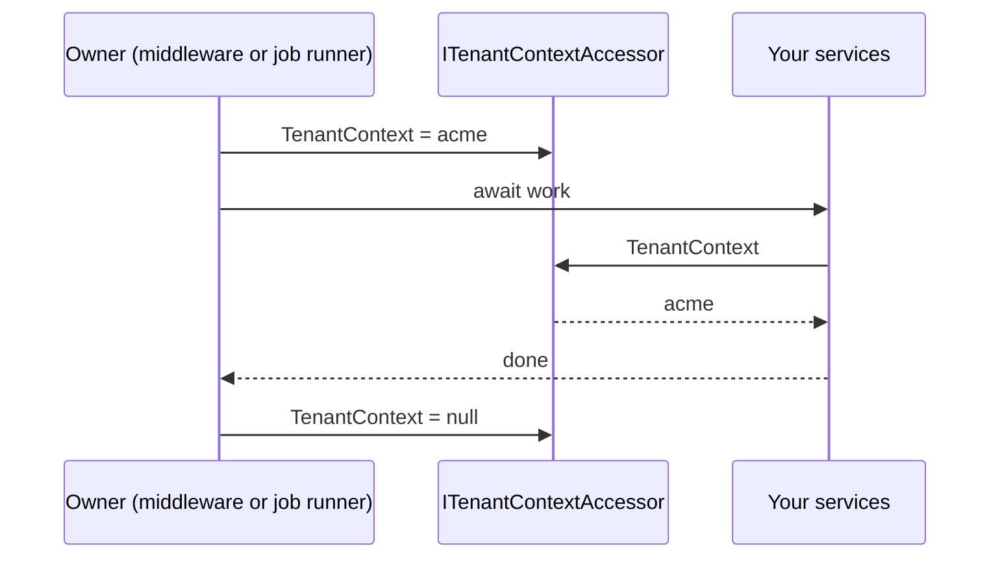

# Tenant context

The tenant context is the answer to **which tenant is this work for?** for the code that is running
right now. The [request pipeline](./aspnetcore/pipeline.md) sets it for HTTP requests; you set it
yourself for background work. Everything else in your application only reads it.

## How it works

`ITenantContextAccessor.TenantContext` holds the current `TenantContext`, or `null` when no tenant has
been established. The default accessor stores the value in an `AsyncLocal<T>`, so it follows the
logical execution context instead of living in a field shared by all requests. It flows across
`await` calls, so every service called during a request sees that request's tenant, and two
concurrent requests never see each other's tenant. Read
[Behavior and limits](#behavior-and-limits) before you rely on it outside a request.



## Register it

::: code-group

```csharp [Full multi-tenancy]
builder.Services.AddMultiTenancy();
```

```csharp [Accessor only]
builder.Services.AddTenantContextAccessor();
```

:::

`AddMultiTenancy()` registers the default accessor as a singleton `ITenantContextAccessor` and returns
a builder for [tenant management](./management/tenants.md) and the
[request pipeline](./aspnetcore/pipeline.md). `AddTenantContextAccessor()` registers only the accessor.
Both are in the `Ayaka.MultiTenancy` namespace.

## Read the current tenant

Inject `ITenantContextAccessor` and read it when you do the work:

```csharp
public sealed class InvoiceService
{
    private readonly ITenantContextAccessor _accessor;

    public InvoiceService(ITenantContextAccessor accessor)
    {
        _accessor = accessor;
    }

    public string CurrentTenantId
        => _accessor.TenantContext?.Id
           ?? throw new InvalidOperationException("No tenant context is active.");
}
```

Read the context during each operation. Don't capture it in a constructor or keep it after the
operation finishes: a service can outlive the request that created it. To test a service that reads
the context, pass a fake `ITenantContextAccessor` with a known value.

## Context and tenant data

A `TenantContext` carries only the tenant's `Id` and an optional `DisplayName`. It is not a
[`Tenant`](./management/tenants.md): the context says *which tenant this work is for*, while the
tenant is a catalog entry with optional attributes. The tenant management resolver copies only the ID
and display name into the context; when you need attributes, look up the `Tenant` through
`ITenantManager` with the context's ID.

## Set the context yourself

Outside HTTP requests, the code that starts the work owns the context. Set it before the work and
clear it in `finally`:

```csharp
accessor.TenantContext = new TenantContext("acme", "Acme");
try
{
    await work();
}
finally
{
    accessor.TenantContext = null;
}
```

Await all tenant-aware work before clearing the context. Don't rely on a context set inside an
async helper becoming the caller's context after the helper returns: it applies to the work
*inside* that helper. The [background work guide](./guides/background-work.md) shows a complete
job runner.

For HTTP requests, let the middleware own the context. It throws if a context is already set when it
handles a tenant-enabled endpoint, so don't set one earlier in the pipeline to influence detection;
write a [detection strategy](./aspnetcore/detection.md) instead.

## Behavior and limits

::: warning The tenant context is ambient state
The default accessor keeps the context in an `AsyncLocal<T>`, the same mechanism as ASP.NET Core's
`IHttpContextAccessor`, and it shares its pitfalls: code reads a value nobody passed to it, a value
set inside an `async` method never reaches its caller, and clearing the context also affects work
that was started from it. `AsyncLocal<T>` also adds a small cost to async calls while a context is
set. These pitfalls are easy to miss in background work and in tests.
:::

- **Clearing reaches inherited work.** Clearing or replacing the context also clears it for work that
  inherited it, such as a task started from the same flow and not awaited. Copy the tenant ID before
  you start detached work instead of reading the accessor later.
- **One current tenant.** Every accessor instance reads and writes the same current tenant; creating a
  second accessor doesn't create a separate scope.
- **No transport.** Execution-context flow can be suppressed and does not cross queues or processes.
  Put the tenant ID into a job or message and set the context where it is processed.
- **DI scopes are independent.** Creating a DI scope neither sets nor isolates the tenant context.
- **No nesting.** There are no nested tenant scopes. For parallel jobs, set the context inside each
  job's own execution flow instead of changing a shared parent context.
